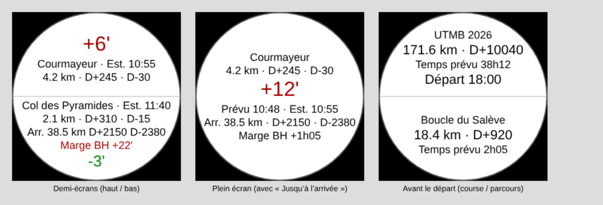
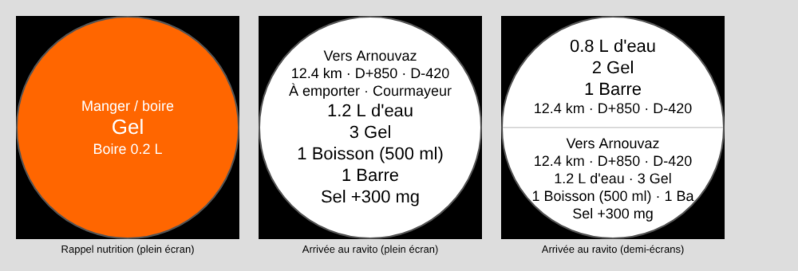

# Champ de données Garmin « Trail Planner »

Champ de données Connect IQ qui s'affiche dans ton activité Trail habituelle (GPS, navigation,
ClimbPro et PacePro continuent de fonctionner) :

- **écart au plan** à l'endroit exact où tu es (`+6'` = 6 min de retard, en rouge ; avance en vert) ;
- **prochain point** : nom, **distance, D+ et D- restants** jusqu'à lui, heure prévue (fixe) et heure
  estimée (recalculée à chaque passage) ;
- **jusqu'à l'arrivée** (réglage « Jusqu'à l'arrivée », désactivé par défaut) : distance, D+ et D- restants
  jusqu'à l'arrivée, en plus de ceux du prochain point ;
- **bouton Lap = passage** au point le plus proche : heure de passage notée, position recalée, heures
  estimées des points suivants recalculées (écran « Passage · nom » 5 s) ; **au ravito, 2e tour = départ**
  du ravito (écran « Départ · nom » 5 s) ;
- **barre de progression** au centre de l'écran : le tronçon en cours d'un ravito au suivant, partie faite
  pleine, un **trait** par point de passage, un **point** par produit à prendre (orange à venir, gris déjà
  rappelé), un triangle à ta position ;
- **marge sur la prochaine barrière horaire**, avec vibration si elle passe sous 30 min ;
- **rappels nutrition** : le **produit prévu** (« Gel », « Barre »…) et l'eau à boire (vibration + écran
  30 s) ; les produits du plan nutrition sont répartis équitablement sur chaque tronçon entre deux ravitos ;
- **à l'arrivée à un ravito** : **pause en cours / prévue**, distance, D+ et D- jusqu'au ravito suivant,
  **à manger sur place** (produits « sur ravito » du plan), et écran « À emporter » (eau,
  produits, sel jusqu'au ravito suivant), comme la colonne « À emporter » du plan nutrition ; l'eau en
  quantité réelle et en flasques de 500 ml (« 1.1 L : 2 eau + 1 iso », l'isotonique n'étant alors plus
  répété dans les produits) ;
- avant le départ : nom, distance, D+ et temps prévu ; heure de départ pour une **course** seulement
  (« Départ libre » si elle est en départ libre), aucune heure pour un **parcours d'entraînement** ; **avec
  quoi partir** (sac du premier tronçon : eau en flasques, produits, sel) ;
- **note du point** (« frontale, veste… », colonne Notes du plan) : sur l'écran du ravito, sous « À emporter » ;
  à un point sans sac, écran du nom du point et de sa note au passage ;
- **suivi pour l'assistance** : passages réels, position et batterie envoyés toutes les 5 min via ton
  téléphone ; ils s'affichent sur le lien assistance de la course (position sur le profil, écart au plan,
  heures estimées recalculées).

*Aperçu approximatif (polices Garmin simulées). Le champ est prévu **en plein écran** (un écran de données
à lui seul) : il n'a plus de mise en page pour demi-écran ou quart d'écran. Un texte trop long passe à une
forme plus courte (« 4.2 km D+245 D-30 », « Arr. » pour l'arrivée), puis est raccourci à la largeur
disponible ; si tout ne tient pas en hauteur, l'écart passe en police moyenne, puis les lignes secondaires
(heure prévue, nom du point) sont retirées.*

**D+ et D- restants.** Le plan contient le profil de dénivelé du parcours (D+ et D- cumulés depuis le
départ, simplifiés à 5 m près, un sommet à chaque point de passage) : le D+ et le D- d'un point au suivant
sont exactement ceux du tableau du plan, et ceux qui restent suivent ta position calée sur le tracé.
Réglage « Jusqu'à l'arrivée » sur la montre (appui long › Champs Connect IQ › Trail Planner) ou dans
Garmin Connect : ajoute la ligne « Arr. 38.5 km D+2150 D-2380 » (absente quand le prochain point est
l'arrivée).

**Rappels nutrition.** Le plan contient les produits du plan nutrition de l'app web, tronçon par tronçon
(départ ou ravito → ravito suivant ou arrivée ; tout le parcours pour un parcours d'entraînement). Sur
chaque tronçon, les n produits sont pris dans un ordre alterné (3 gels et 2 barres : gel, barre, gel,
barre, gel) et répartis équitablement : le j-ième au milieu de sa part du tronçon en temps prévu
(départ du ravito + (j − ½) / n × durée prévue). Le rappel tombe à l'endroit correspondant du parcours :
si le tronçon prend plus de temps que prévu, les rappels s'espacent et les produits emportés durent
jusqu'au ravito suivant. L'écran indique le produit et l'eau à boire d'ici le rappel suivant (eau du
tronçon / nombre de produits). Réglage « Rappel nutrition » dans Garmin Connect : -1 (par défaut) = ces
rappels, N = « Manger / boire » toutes les N minutes, 0 = aucun rappel. Sans produits dans le profil
athlète, rappel « Manger / boire » au rythme des glucides du plan. **Notifications** (réglage « Notifications » sur la montre,
activé par défaut, aussi dans Garmin Connect) : chaque rappel « Manger / boire » s'affiche aussi en
notification de la montre (alerte du champ de données : écran orange avec le produit et l'eau à boire,
par-dessus l'écran de l'activité en cours, même si le champ Trail Planner n'est pas affiché) ; désactivé,
le rappel reste seulement dans le champ.

**Arrivée à un ravito.** Dès le passage (position ou 1er tour Lap), l'écran du ravito affiche :
« Pause 3:25 / 5:00 » (temps depuis l'arrivée / arrêt prévu, en rouge une fois dépassé), le tronçon suivant
(« Vers Arnouvaz », « 12.4 km · D+850 · D-420 » jusqu'au ravito suivant ou à l'arrivée, comme le tableau du
plan), « Manger ici » (produits cochés « Sur ravito » dans le profil : banane, bouillon…), puis « À emporter
· nom du ravito » : la note du point, l'eau, les produits et le sel à prendre pour ce tronçon. Il reste
affiché **jusqu'au 2e tour Lap** (départ du ravito : les heures estimées repartent du départ réel au lieu de
l'arrivée + arrêt prévu), ou 300 m après le ravito si tu repars sans appuyer. Si la place manque, le nom du
ravito suivant est retiré d'abord. Un 1er tour au ravito alors que le GPS a déjà noté l'arrivée la recale à
l'instant du tour ; le 2e tour est le départ. Sans 2e tour, le départ est noté tout seul 150 m après le
ravito. Le départ est envoyé à l'assistance avec le passage (`indice:arrivée:départ`) : le lien assistance
affiche le temps réellement passé au ravito (et l'écart à l'arrêt prévu).

**Barre de progression.** Sous l'écart, une barre montre le tronçon en cours, du dernier ravito passé (ou
du départ) au suivant (ou à l'arrivée) : les traits sont les points de passage du tronçon, les points les
produits à prendre, placés là où tombera leur rappel (orange à venir, gris déjà rappelés).

**Heures prévues et estimées.** Les heures prévues restent celles du plan pendant toute l'activité. Les
heures estimées des points sont recalculées **à chaque passage** (bouton Lap, ou point atteint d'après la
position) d'après ce qui a déjà été fait : rythme réel au dernier point passé par rapport au plan, prolongé
sur la suite (amorti de 30 %, borné), arrêts prévus non étirés ; entre deux passages elles ne bougent pas.
Avant le premier passage, estimé = prévu. L'écart au plan (`+6'`), lui, suit ta position en continu. Même
règle dans le mode course de l'app ; le lien assistance, lui, recalcule les estimations à chaque relevé de
la montre (position et rythme réel) et ignore un passage noté à plus de 300 m devant ta position.

**Bouton Lap.** Un tour valide le passage au point le plus proche pas encore validé : avec le GPS calé sur le
tracé, à 150 m au plus devant toi ou 300 m derrière (500 m dans les deux sens si le tracé n'est pas calé ou si
le plan n'a pas de tracé) ; un tour loin de tout point est ignoré. Un passage (tour ou position) est annulé si
le GPS calé te place ensuite à plus de 200 m avant le point : il sera détecté de nouveau en y arrivant.

**Barrières horaires hors du jour de course.** Le plan donne aussi le départ prévu ; si l'activité démarre à
plus de 6 h de lui (entraînement sur le parcours, départ libre, simulateur), les barrières sont décalées
d'autant au lieu d'afficher un « Hors délai » de plusieurs centaines d'heures. Le jour de la course, elles
restent aux heures fixées.
**Désactive le tour automatique (Auto Lap)** de ton activité Trail, sinon un tour auto tombant près d'un
point le validerait. Réglage « Tour = passage au point » sur la montre (appui long › Champs Connect IQ ›
Trail Planner) pour couper cette fonction.

**Position le long du parcours : GPS calé sur le tracé.** Le plan contient le tracé simplifié du
parcours ; à chaque seconde, la position GPS est ramenée sur ce tracé, près de l'endroit attendu (dernier
calage + distance faite depuis). La distance de la montre ne sert qu'entre deux relevés : pas d'erreur
cumulée (distance GPS trop longue ou trop courte), et un raccourci ou un détour se recale dès le retour sur
le tracé. Hors du tracé (5 s de suite), la distance reste figée et le champ affiche **« Hors parcours ·
N m »** en rouge ; sans GPS (tunnel…), elle avance avec la distance de la montre. Un aller-retour ou une
boucle qui repasse au même endroit ne trompe pas le calage (il cherche près de la position attendue).
Si le parcours change (modifié dans l'app web), la montre reçoit le nouveau plan dans les 5 min et se
recale sur tout le parcours, en gardant les passages déjà notés. Plan d'une ancienne version (sans
tracé) : navigation du parcours FIT si elle est active, sinon distance parcourue.

## 1. Envoyer une course à la montre (app web)

Connecté : touche **⌚** sur la ligne d'une course ou d'un parcours (ou « Mettre sur la montre » dans son
plan). Ton **code de synchronisation à 8 chiffres** (le même pour toutes tes courses, et le même que pour
EndurancePro) et le code long pour Garmin Connect sont dans l'**onglet Montre**. Pour changer de course,
touche ⌚ sur une autre : la montre la récupère d'elle-même.

## 2. Compiler le champ

1. Installe le **SDK Connect IQ** : <https://developer.garmin.com/connect-iq/sdk/> (SDK Manager → dernier SDK
   + le profil de ta montre).
2. Installe **VS Code** et l'extension **Monkey C** (Garmin), puis « Monkey C: Generate a Developer Key ».
3. Ouvre le dossier `garmin/TrailPlannerField`.
4. Ta montre doit figurer dans `manifest.xml` (`<iq:products>`). Montres prévues : **Enduro 3**,
   **epix 2**, **Forerunner 255, 265, 955 et 965**, et la famille **fēnix** :
   - fēnix 5 Plus, 5S Plus, 5X Plus (`fenix5plus`, `fenix5splus`, `fenix5xplus`) ;
   - fēnix 6 Pro, 6S Pro, 6X Pro, Solar et Sapphire compris (`fenix6pro`, `fenix6spro`, `fenix6xpro`) ;
   - fēnix 7, 7S, 7X et 7 Pro, 7S Pro, 7X Pro (`fenix7`, `fenix7s`, `fenix7x`, `fenix7pro`, `fenix7spro`,
     `fenix7xpro`, et `fenix7pronowifi`, `fenix7xpronowifi` pour les Pro sans Wi-Fi) ;
   - fēnix 8 AMOLED 43 et 47/51 mm, 8 Solar 47 et 51 mm, 8 Pro (`fenix843mm`, `fenix847mm`,
     `fenix8solar47mm`, `fenix8solar51mm`, `fenix8pro47mm`) ;
   - fēnix 9, 9 Pro, 9 Pro Solar (`fenix943mm`, `fenix947mm`, `fenix9pro43mm`, `fenix9pro47mm`,
     `fenix9pro51mm`, `fenix9prosolar47mm`, `fenix9prosolar51mm`) et fēnix E (`fenixe`).

   Pas de fēnix 3, 5, 5S, 5X ni Chronos (Connect IQ 3.1 au plus, il faut la 3.2), ni de fēnix 6 et 6S
   sans « Pro » (32 Ko de mémoire pour un champ de données : trop peu pour le plan et le tracé). Pour une
   autre montre : « Monkey C: Edit Products ».
5. « Monkey C: Build for Device » → choisis ta montre → un fichier `.prg` est créé dans `bin/`.

Pour essayer sans montre : « Monkey C: Run » lance le simulateur (fēnix 5 Plus et 6 Pro : vérifie-y aussi
la mémoire de la tâche de fond, 32 Ko sur ces montres, avec le plan d'un ultra). Charge un parcours (*Simulation →
Activity Data → FIT/GPX*) et règle le code via *File → Edit Persistent Storage / Application Properties*.

## 3. Installer et régler

**Par câble (le plus rapide pour tester)** : branche la montre en USB et copie le `.prg` dans
`GARMIN/APPS/`. Les réglages de l'app Garmin Connect ne sont pas disponibles pour une installation par
câble : **saisis le code à 8 chiffres sur la montre**. Pendant une activité, appui long sur Haut (menu) ›
Champs Connect IQ › Trail Planner › Code montre, règle les 8 chiffres et valide (00000000 efface le code).
Autre possibilité : coller le code long dans `resources/settings/properties.xml`
(`<property id="code" …>TON_CODE</property>`) avant de compiler.

**Par le Connect IQ Store (version « bêta » privée)** : publie le `.iq` (« Monkey C: Export Project ») en
bêta sur <https://apps.garmin.com/developer>. Une fois installé depuis le Store, les réglages sont
modifiables dans l'app Garmin Connect : *Appareils → ta montre → Activités et applications → Trail Planner
→ Paramètres* (code montre, intervalle des rappels nutrition, vibrations, distance et dénivelé jusqu'à
l'arrivée).

Puis, sur la montre : activité **Trail → Paramètres → Écrans de données** → ajoute un champ
**Connect IQ → Trail Planner** sur un écran de données **à un seul champ (plein écran)**.

## 4. Le jour de la course

1. Dans l'app web, la course est « Sur la montre ✓ ». Le parcours FIT (navigation, flèches) reste utile
   pour te guider, mais le champ n'en a plus besoin : il a son propre tracé.
2. Quelques minutes avant le départ, **ouvre l'activité Trail avec le parcours, téléphone à proximité** :
   le champ télécharge le plan (contrôle toutes les 5 min, minimum imposé par Garmin) et affiche le nom,
   la distance, le D+, le temps prévu et « Départ hh:mm ».
3. Démarre l'activité : le champ fonctionne ensuite sans réseau. Si ton téléphone est avec toi, ton
   assistance suit ta progression sur le lien assistance de la course (créé depuis l'app web,
   « 👥 Lien assistance »).

Messages possibles : « Saisis le code montre », « Plan en attente... » (pas encore téléchargé : téléphone
connecté ?), « Code inconnu » (code erroné ou course pas encore envoyée), « Plan : erreur N ».

## Limites connues

- Écrit sans accès au SDK Garmin : la première compilation peut demander de petites corrections
  (signale-les, avec le message d'erreur).
- Mémoire limitée : le plan tient en 7 Ko au plus (limite de la tâche de fond Garmin : 8 Ko). Le profil
  de dénivelé prend au plus un tiers de la place restante (simplifié à 5 m près, moins finement sur un
  ultra, au pire seulement aux points de passage) ; le tracé prend le reste, et passe avant le profil s'il
  ne tient pas sans lui : simplifié à 8 m près sur un trail court, jusqu'à 100–200 m sur un ultra avec
  beaucoup de points (UTMB) ; dans les lacets simplifiés, la distance de la montre prend le relais à
  l'intérieur du segment, et l'écart reste de l'ordre de 100–200 m au lieu de plusieurs km cumulés.
- Suivi pour l'assistance : toutes les 5 min au mieux (minimum imposé par Garmin), et seulement si le
  téléphone est avec toi, l'app Garmin Connect connectée et du réseau mobile. Sans réseau, les passages
  restent sur la montre et partent au prochain envoi réussi.
