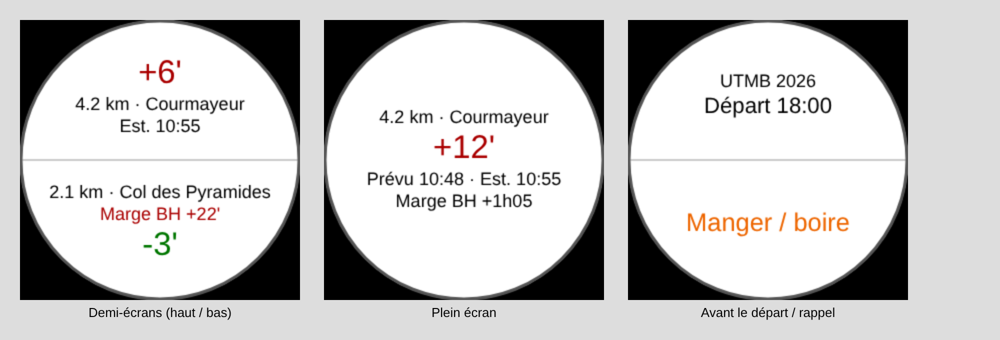

# Champ de données Garmin « Trail Planner »

Champ de données Connect IQ qui s'affiche dans ton activité Trail habituelle (GPS, navigation,
ClimbPro et PacePro continuent de fonctionner) :

- **écart au plan** à l'endroit exact où tu es (`+6'` = 6 min de retard, en rouge ; avance en vert) ;
- **prochain point** : nom, distance, heure prévue et heure estimée ;
- **marge sur la prochaine barrière horaire**, avec vibration si elle passe sous 30 min ;
- **rappels nutrition** (vibration + écran « Manger / boire » 30 s) selon ton plan ;
- avant le départ : nom de la course et heure de départ prévue ;
- **suivi pour l'assistance** : passages réels, position et batterie envoyés toutes les 5 min via ton
  téléphone ; ils s'affichent sur le lien assistance de la course (position sur le profil, écart au plan,
  heures estimées recalculées).

*Aperçu approximatif (polices Garmin simulées). Sur écran rond, l'écart — le texte le plus court — se
place du côté du bord arrondi et les textes trop longs sont raccourcis à la largeur disponible.*

L'estimation reprend la logique du mode course de l'app : le retard observé se prolonge sur la suite,
amorti et borné. La position le long du parcours vient de la navigation du parcours FIT exporté par l'app
(plus fiable que la distance de la montre) ; sans parcours chargé, la distance parcourue est utilisée.

## 1. Envoyer une course à la montre (app web)

Connecté, sur la page d'une course : **⌚ Mettre sur la montre**. L'app affiche ton **code montre**
(le même pour toutes tes courses). Pour changer de course, clique « Mettre sur la montre » sur une autre :
la montre la récupère d'elle-même.

## 2. Compiler le champ

1. Installe le **SDK Connect IQ** : <https://developer.garmin.com/connect-iq/sdk/> (SDK Manager → dernier SDK
   + le profil de ta montre).
2. Installe **VS Code** et l'extension **Monkey C** (Garmin), puis « Monkey C: Generate a Developer Key ».
3. Ouvre le dossier `garmin/TrailPlannerField`.
4. Ta montre doit figurer dans `manifest.xml` (`<iq:products>`, l'Enduro 3 y est : `enduro3`).
   Sinon : « Monkey C: Edit Products ».
5. « Monkey C: Build for Device » → choisis ta montre → un fichier `.prg` est créé dans `bin/`.

Pour essayer sans montre : « Monkey C: Run » lance le simulateur. Charge un parcours (*Simulation →
Activity Data → FIT/GPX*) et règle le code via *File → Edit Persistent Storage / Application Properties*.

## 3. Installer et régler

**Par câble (le plus rapide pour tester)** : branche la montre en USB et copie le `.prg` dans
`GARMIN/APPS/`. Les réglages de l'app Garmin Connect ne sont pas disponibles pour une installation par
câble : **colle ton code montre dans `resources/settings/properties.xml`** (`<property id="code" …>TON_CODE</property>`)
avant de compiler.

**Par le Connect IQ Store (version « bêta » privée)** : publie le `.iq` (« Monkey C: Export Project ») en
bêta sur <https://apps.garmin.com/developer>. Une fois installé depuis le Store, les réglages sont
modifiables dans l'app Garmin Connect : *Appareils → ta montre → Activités et applications → Trail Planner
→ Paramètres* (code montre, intervalle des rappels nutrition, vibrations).

Puis, sur la montre : activité **Trail → Paramètres → Écrans de données** → ajoute un champ
**Connect IQ → Trail Planner** (idéalement en grand : demi-écran ou plein écran).

## 4. Le jour de la course

1. Dans l'app web, la course est « Sur la montre ✓ » ; exporte aussi son parcours FIT et charge-le sur la
   montre (navigation).
2. Quelques minutes avant le départ, **ouvre l'activité Trail avec le parcours, téléphone à proximité** :
   le champ télécharge le plan (contrôle toutes les 5 min, minimum imposé par Garmin) et affiche
   « Départ hh:mm ».
3. Démarre l'activité : le champ fonctionne ensuite sans réseau. Si ton téléphone est avec toi, ton
   assistance suit ta progression sur le lien assistance de la course (créé depuis l'app web,
   « 👥 Lien assistance »).

Messages possibles : « Saisis le code montre », « Plan en attente... » (pas encore téléchargé : téléphone
connecté ?), « Code inconnu » (code erroné ou course pas encore envoyée), « Plan : erreur N ».

## Limites connues

- Écrit sans accès au SDK Garmin : la première compilation peut demander de petites corrections
  (signale-les, avec le message d'erreur).
- Mémoire limitée : le plan est compacté (≈ 2–4 Ko pour un ultra comme l'UTMB, précision ±1 min).
- Suivi pour l'assistance : toutes les 5 min au mieux (minimum imposé par Garmin), et seulement si le
  téléphone est avec toi, l'app Garmin Connect connectée et du réseau mobile. Sans réseau, les passages
  restent sur la montre et partent au prochain envoi réussi.
