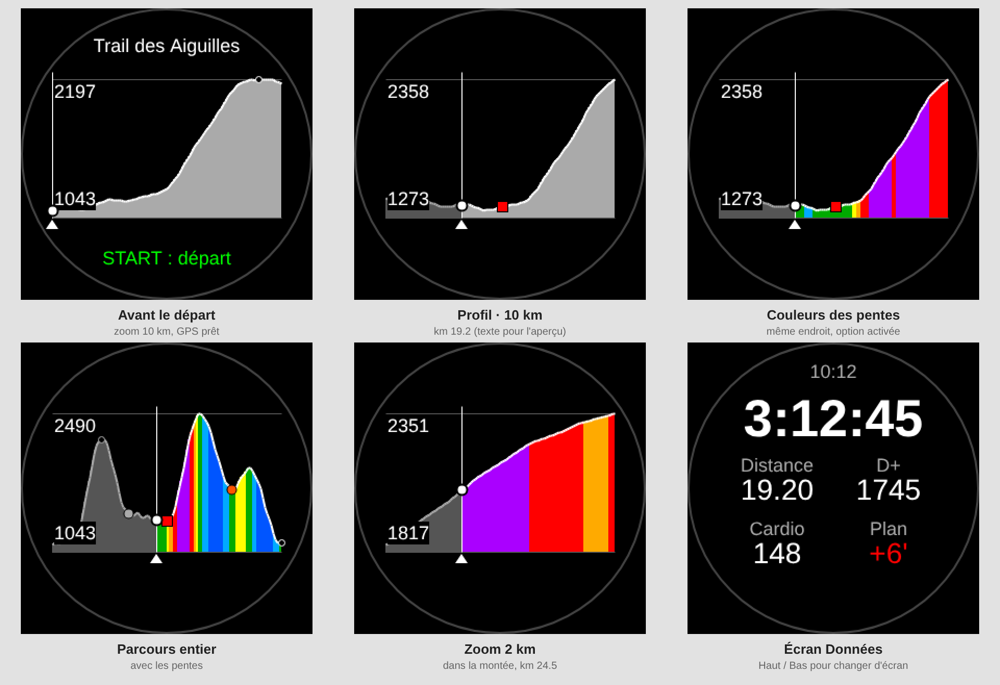

# Appli montre « Trail Planner Companion »

Appli Connect IQ pour montres Garmin (une **appli**, pas un champ de données) qui **enregistre ta sortie
Trail** avec le plan de la course envoyé par l'app web, et affiche son **profil qui te suit**, zoomable.

Elle complète le champ de données Trail Planner (`garmin/TrailPlannerField`), qui continue de s'utiliser
dans l'activité Trail de Garmin. Pendant une activité, Garmin n'affiche que des champs de données, et un
champ ne réagit pas aux boutons : pour avoir le profil zoomable, il faut lancer la sortie depuis cette appli.

**État :** première version, à compiler et à tester sur la montre (pas de SDK Connect IQ dans les sessions
Claude). Gratuite pendant la bêta. Le passage au payant viendra plus tard : rien dans l'appli pour l'instant.

*Aperçu approximatif (polices Garmin simulées), dessiné à partir d'une course de 42 km et du même calcul
que l'appli.*

## Écrans (Haut / Bas pour passer de l'un à l'autre)

**Profil de la course** (sans km ni nom de point) :
- la portion de parcours du **zoom choisi** (parcours entier, 20, 10, 5 ou 2 km), toi au **tiers gauche**
  comme sur la page assistance : tu vois surtout ce qui t'attend ;
- **altitudes ajustées à la portion affichée** (100 m d'écart au moins, pour ne pas grossir le plat), avec
  la plus haute et la plus basse à gauche ;
- partie faite en gris foncé, partie à venir en gris clair ou en **couleurs des pentes** (option) ;
- points de passage sans nom : ravito (rond orange), base de vie (carré rouge), autres (petit rond),
  grisés une fois passés ;
- ta position : trait vertical, point sur le profil, triangle sous la ligne de base. Elle suit le GPS
  **calé sur le tracé** du plan, comme le champ (« Hors parcours · N m » en haut si tu t'en écartes).

**Couleurs des pentes** (désactivées par défaut). Montée : vert < 5 %, jaune 5–10 %, orange 10–15 %,
rouge 15–25 %, violet 25 % et plus. Descente : bleu clair de −5 à −15 %, bleu foncé au-delà. Entre −5 et
5 % : vert. La pente est une moyenne sur 1/20 au moins de la portion affichée (100 m au zoom 2 km, 500 m
au zoom 10 km), pour que les petites bosses ne zèbrent pas une montée.

**Données** : heure, chrono, distance (le long du parcours une fois calée sur le tracé), D+, cardio,
**écart au plan** à l'endroit où tu es (`+6'` = 6 min de retard, en rouge ; avance en vert).

## Boutons

| Bouton | Avant le départ | Pendant la sortie | En pause |
|---|---|---|---|
| START | Démarrer | Pause (menu Reprendre / Enregistrer / Supprimer) | Reprendre |
| BACK (Lap) | Quitter l'appli | Nouveau tour | Menu de pause |
| Haut / Bas | Écran suivant | Écran suivant | Écran suivant |
| Appui long sur Haut | Menu | Menu | Menu |

Écran tactile : balayages pour changer d'écran. Un balayage « retour » ne coupe pas la sortie, et un tap
ne fait rien : START et BACK restent sur les boutons. « Supprimer » demande une confirmation.

**Menu** (appui long sur Haut) : **Zoom du profil**, **Couleurs des pentes**, **Code montre** (8 chiffres),
**Recharger le plan**. Zoom, couleurs des pentes et code se règlent aussi dans Garmin Connect (appli
installée depuis le Store).

## Plan de la course

L'appli lit le **même document que le champ** : saisis le **même code montre** (onglet Montre de l'app
web), puis envoie une course à la montre avec la touche ⌚. Le plan est téléchargé via le téléphone au
lancement, puis toutes les 5 minutes. Deux champs du document :
- `w`, le plan compact du champ (format TP1, `src/lib/watch.ts`) : nom, points de passage, temps prévus,
  tracé pour caler le GPS ;
- `wp`, le **profil fin** de l'appli (format TPP1, `watchProfile`) : altitudes le long du parcours à 2 m
  près sur une course normale, jusqu'à 6 000 caractères. Sur un ultra d'essai de 170 km, il garde plus de
  700 points, contre 50 à 150 sommets pour la ligne de dénivelé du plan du champ (qui laisse la place au
  tracé GPS).

`wp` n'existe que dans le document du code montre. Il est ajouté la première fois que tu ouvres l'app web
après sa mise à jour. Avant, l'appli dessine le profil d'après le plan seul : forme plus grossière, sans
altitudes affichées.

## Ce qui change par rapport à l'activité Trail de Garmin

- La sortie est enregistrée en **course à pied / trail** (fichier FIT avec GPS, cardio, tours), envoyée à
  Garmin Connect et à Strava comme une activité Trail.
- **Pas de carte, de guidage, de ClimbPro ni de PacePro** de Garmin pendant cette activité. Le tracé du
  plan sert seulement à caler ta position.
- **Le champ Trail Planner ne s'affiche pas** dans une appli Connect IQ. Sa nutrition, ses barrières
  horaires, l'écran du ravito et le **suivi pour l'assistance** ne sont pas encore dans l'appli.

## Compiler et installer

Comme le champ (voir `garmin/README.md`, sections 2 et 3) :
1. Dans VS Code avec l'extension Monkey C, ouvre le dossier `garmin/TrailPlannerCompanion`.
2. « Monkey C: Build for Device », choisis ta montre : un `.prg` est créé dans `bin/`.
3. Copie-le dans `GARMIN/APPS/` (montre branchée en USB). L'appli apparaît dans la liste des activités et
   applis.
4. Règle le code montre dans le menu de l'appli (appui long sur Haut › Code montre).

Montres prévues : les mêmes que le champ (Enduro 3, epix 2, fēnix 5 Plus à 9 et E, Forerunner 255, 265,
955 et 965). L'identifiant Connect IQ de l'appli est propre à elle (`manifest.xml`).

**À vérifier à la première compilation :**
- sport de l'activité (`Activity.SPORT_RUNNING` / `Activity.SUB_SPORT_TRAIL` dans `Run.mc`). Si le
  compilateur ne les trouve pas pour une vieille montre (fēnix 5 Plus), remplacer par
  `ActivityRecording.SPORT_RUNNING` et `ActivityRecording.SUB_SPORT_TRAIL` ;
- mémoire avec le plan d'un ultra (simulateur : *File › View Memory*), surtout sur fēnix 5 Plus et 6 Pro ;
- au simulateur, charge un parcours (*Simulation › Activity Data*) et démarre la sortie avec START : le
  profil doit défiler avec toi.
