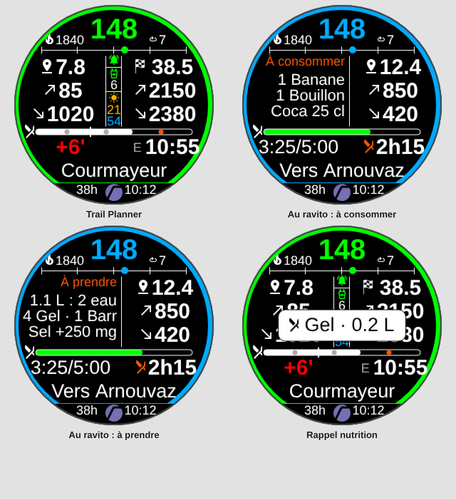
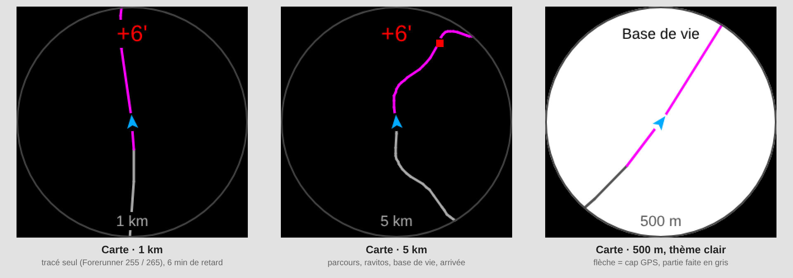

# Appli montre « Trail Planner Companion »

Appli Connect IQ pour montres Garmin (une **appli**, pas un champ de données) qui **enregistre ta sortie
Trail** avec :
- un **écran de démarrage** façon Komoot : tes courses à venir et les parcours de ta bibliothèque,
  synchronisés depuis l'app web, avec leur fiche (résumé d'avant départ, comme le champ Trail Planner) ;
- l'**écran et les calculs d'EndurancePro 2.7.3**, à l'identique (allure effort, VAM, zones, alarmes,
  données FIT, menu de réglages, 6 langues, thèmes clair et sombre), et **ses bandeaux du haut et du bas
  sur tous les écrans** ;
- l'**écran Trail Planner** au style d'EndurancePro : les calculs du champ Trail Planner (écart au plan,
  prochain point, arrivée, barrières, rappels nutrition, ravitos) avec les éléments graphiques d'EP ;
- le **profil de la course qui te suit**, zoomable, avec l'écart au plan ;
- la **carte** : ton parcours Trail Planner sur le fond de carte Garmin de la montre, centrée sur toi ;
- le **suivi pour l'assistance** (passages, position, batterie), comme le champ Trail Planner.

Le champ de données Trail Planner (`garmin/TrailPlannerField`) continue de s'utiliser dans l'activité
Trail de Garmin ; l'appli en reprend l'écran et les calculs pour qui lance la sortie depuis elle (profil
zoomable, carte, EndurancePro sur la même activité).

**État :** version 0.6.2, à compiler et à tester sur la montre (pas de SDK Connect IQ dans les sessions
Claude). Gratuite pendant la bêta. Le passage au payant viendra plus tard : rien dans l'appli pour l'instant.

*Écran Trail Planner, au ravito (« À consommer » puis « À prendre ») et rappel nutrition : aperçus avec les
icônes et les positions d'EndurancePro sur Enduro 3, polices simulées.*

*Aperçu approximatif de l'écran du profil (polices Garmin simulées), dessiné à partir d'une course de
42 km et du même calcul que l'appli ; dans l'appli, les bandeaux d'EP l'entourent en haut et en bas.*

*Écran Carte en tracé seul (montres sans cartes) ; sur les montres à cartes, le même tracé et les mêmes
repères sont posés sur le fond de carte Garmin, qui ne peut pas être simulé ici. Dans l'appli, les
bandeaux d'EP l'entourent en haut et en bas.*

## Démarrage (façon Komoot)

1. **Liste** : tes courses à venir (par date) puis les parcours de ta bibliothèque (par nom), avec
   distance, D+ et date ; la course envoyée à la montre (⌚) est présélectionnée. Sans synchronisation des
   parcours, la liste propose la course envoyée à la montre. En bas : **Sortie libre** (sans plan :
   écrans EndurancePro et Carte seulement, Haut / Bas passent de l'un à l'autre) et **Réglages**.
2. **Fiche** du parcours choisi : le **résumé d'avant départ du champ Trail Planner** (nom, distance · D+,
   temps prévu, heure de départ ou « Départ libre », « Emporter au départ » et le sac du premier
   tronçon). START : démarrer ; appui long sur Haut : réglages ; BACK : liste.
3. **Écrans de course**, en attente du GPS (« GPS... » en rouge, puis « START : départ » en vert) ; START pour partir. Avant le départ,
   BACK ramène à la liste. **Pendant la sortie**, la liste ne reste jamais affichée : si la montre retire
   l'écran de course (BACK / Lap), il revient aussitôt et le tour est noté ; impossible de choisir un autre
   parcours avant la fin de la sortie.

La liste et le plan du parcours choisi sont téléchargés via le téléphone (au lancement puis toutes les
5 minutes) : active **« Synchroniser mes parcours avec l'appli »** dans l'onglet Montre de l'app web
(encart Trail Planner Companion, bêta).

## Écrans (Haut / Bas pour passer de l'un à l'autre)

**Bandeaux d'EndurancePro sur tous les écrans** : en haut, la FC (valeur et anneau coloré par zone), la
2e métrique, le tour et la barre de zone FC ; en bas, le trait coloré par la FC, l'autonomie, l'icône du
mode d'allure et l'heure. Le popup d'alarme d'EndurancePro (et celui des rappels Trail Planner)
s'affiche par-dessus, quel que soit l'écran.

**1. EndurancePro** : l'écran du champ EndurancePro 2.7.3, sans changement sauf la distance restante, qui
vient du plan Trail Planner (prochain point, arrivée). FC dans un cercle et sa
barre de zones, D+, D- et altitude, VAM, allure effort instantanée et moyenne colorées par zone, sac,
météo, batterie, distance, chrono, heure, 2e métrique, circuits, alarmes (popup ou notification).

**2. Trail Planner** : les calculs du champ Trail Planner, avec les éléments graphiques d'EndurancePro :
- **colonne gauche** : vers le prochain point (distance, D+, D-) ; **colonne droite** : vers l'arrivée ;
  **colonne centrale** : celle d'EndurancePro (alarme, sac, soleil, température, humidité) ;
- **barre** (à la place de la batterie d'EP) : progression d'un ravito au suivant, un trait par point de
  passage, un point par produit à prendre (orange à venir, gris déjà rappelé) ;
- **sous la barre** : écart réel / prévu (`+6'` en rouge = 6 min de retard, avance en vert) et heure
  estimée au prochain point ;
- **dernière ligne** (à la place du chrono, dans la plus grande police qui tient le texte entier) : le
  prochain point, en alternance (5 s) avec la marge sur la
  prochaine barrière horaire ; « Passage · nom » ou « Départ · nom » 5 s après un tour ; « Hors
  parcours » ; la note d'un point au passage ;
- **au ravito**, jusqu'au départ : à gauche **« À consommer »** (produits sur ravito) puis **« À prendre »**
  (sac : eau, produits, sel, note du point), 5 s chacun, chaque ligne dans la plus grande police qui tient
  (jusqu'à la plus petite, plutôt que de couper) ; à droite le tronçon suivant ; la barre se
  remplit avec le **temps passé sur l'arrêt prévu** (rouge une fois dépassé), « 3:25/5:00 » dessous, et à
  droite la **durée prévue du tronçon suivant**, corrigée de ton rythme ;
- avant le départ : vers le premier point et vers l'arrivée, temps prévu du parcours, « GPS... » puis
  « START : départ » en dernière ligne ;
- l'**heure d'arrivée estimée** (à droite sous la barre) est calée sur le bord de l'écran rond ; pas
  d'icône à côté de la barre ;
- **rappels nutrition** (« Gel · 0.2 L », 30 s) et **alerte de barrière** (sous 30 min, 10 s) en popup
  d'EndurancePro, sur tous les écrans, avec vibration.

C'est aussi le **moteur de suivi de toute l'appli** : position calée sur le tracé, passages (position ou
Lap), estimations ; le profil, la carte et l'envoi à l'assistance lisent ses données. La position vient
du **GPS** et non de la distance parcourue, comme dans le champ (voir `garmin/README.md`, « Position le long
du parcours ») : premier calage sur les 2 premiers km ou après 2 min de suite sur le tracé ailleurs, rien ne
compte avant ; sans GPS, relais par la distance de la montre 500 m au plus, seulement si tu étais sur le
tracé juste avant.

**Bascule automatique** : à l'arrivée à un ravito, l'appli affiche l'écran Trail Planner (quel que soit
l'écran en cours), puis revient à l'écran d'avant au départ du ravito. Pas de bascule par-dessus un menu
ni pendant l'exploration de la carte ; changer d'écran à la main annule le retour.

**3. Profil de la course** (sans km ni nom de point) :
- en haut, l'**écart au plan** à l'endroit où tu es (`+6'` = 6 min de retard, en rouge ; avance en
  vert). À la place, pendant 5 s : « Passage · nom », « Départ · nom » ou « Tour N » après un tour ;
  « Hors parcours · N m » si tu t'écartes du tracé ; « Pause » ; rien avant le départ (pas de titre) ;
- la portion de parcours du **zoom choisi** (parcours entier, 20, 10, 5 ou 2 km, toi au **tiers gauche**
  comme sur la page assistance : tu vois surtout ce qui t'attend), ou le **tronçon en cours** (du point de
  passage précédent au suivant, **par défaut**), ou **d'un ravito à l'autre** (ravitos et bases de vie) ;
  **appui long sur Haut** depuis le profil : choix du zoom ;
- **altitudes ajustées à la portion affichée** (100 m d'écart au moins, pour ne pas grossir le plat), avec
  la plus haute **au-dessus de sa ligne** et la plus basse **sous la ligne de base**, hors du profil, du côté
  opposé à toi ;
- partie faite et partie à venir en deux gris, ou à venir en **couleurs des pentes** (option) ;
- points de passage sans nom : ravito (rond orange), base de vie (carré rouge), autres (petit rond),
  grisés une fois passés ;
- ta position : trait vertical, point sur le profil, triangle sous la ligne de base, d'après le GPS
  **calé sur le tracé** du plan, comme le champ ;
- une alarme d'EndurancePro en mode popup s'affiche aussi sur cet écran.

**Couleurs des pentes** (désactivées par défaut). Montée : vert < 5 %, jaune 5–10 %, orange 10–15 %,
rouge 15–25 %, violet 25 % et plus. Descente : bleu clair de −5 à −15 %, bleu foncé au-delà. Entre −5 et
5 % : vert. La pente est une moyenne sur 1/20 au moins de la portion affichée (100 m au zoom 2 km, 500 m
au zoom 10 km), pour que les petites bosses ne zèbrent pas une montée.

**4. Carte** : carte orientée nord, centrée sur toi (flèche bleue = cap GPS) :
- **ton parcours Trail Planner** en magenta (tracé fin envoyé par l'app web, à 3 m près sur une course
  normale), les ravitos, bases de vie et l'arrivée en repères ;
- **fond de carte Garmin** de la montre (chemins, relief, noms) sur les montres à cartes ; sur les autres
  (Forerunner 255 et 265), **tracé seul** sur le fond du thème, partie faite en gris, ravito rond orange,
  base de vie carré rouge ;
- **échelle** choisie par **appui long sur Haut** depuis la carte (ou dans le menu : largeur de l'écran,
  200 m, 500 m, 1 km par défaut, 2 km, 5 km), rappelée en bas ; pas de titre en haut ; à chaque retour sur
  la carte, elle se pose tout de suite sur toi ;
- **Explorer la carte** (menu, montres à cartes) : la carte passe en mode exploration Garmin pour la
  déplacer et zoomer avec les boutons ; BACK revient au suivi ;
- en haut, comme sur le profil : écart au plan, passages, « Hors parcours ».

**Thème** : celui d'EndurancePro (réglage *Mode sombre*, dossier Affichage), sur tous les écrans.

**Avant le départ** : en bas de chaque écran (à la place du chrono sur EndurancePro, de la dernière ligne
sur Trail Planner), « GPS... » en rouge tant que le GPS cherche, puis « START : départ » en vert. **En
pause** : chrono d'EndurancePro en orange, « START : reprendre » en orange sur le profil et la carte. Pas
d'anneau au bord de l'écran (celui de la FC d'EndurancePro reste).

## Boutons

| Bouton | Avant le départ | Pendant la sortie | En pause |
|---|---|---|---|
| START | Démarrer | Pause (menu Reprendre / Enregistrer / Supprimer) | Reprendre |
| BACK (Lap) | Retour à la liste des parcours | Nouveau tour et passage au point | Menu de pause |
| Haut / Bas | Écran suivant (EP, Trail Planner, profil, carte) | Écran suivant | Écran suivant |
| Appui long sur Haut | Menu ; zoom depuis le profil, échelle depuis la carte | Idem | Idem |

Écran tactile : balayages pour changer d'écran. Un balayage « retour » ne coupe pas la sortie, et un tap
ne fait rien : START et BACK restent sur les boutons. « Supprimer » demande une confirmation.

**Tour = passage au point** (comme le champ, réglage activé par défaut). Chaque tour crée un tour dans le
fichier FIT et un nouveau circuit EndurancePro. Il valide aussi le passage au point le plus proche pas
encore validé : à 150 m au plus devant toi ou 300 m derrière avec le GPS calé sur le tracé, 500 m sinon.
Ta position est alors recalée sur le point. Au ravito, le **2e tour = départ** du ravito ; sans 2e tour,
le départ est noté tout seul 150 m après le ravito (300 m après une base de vie). Les points sont aussi
validés tout seuls par la position. Un passage est annulé si le GPS calé te place ensuite à plus de 200 m
avant le point. Désactive le réglage si tu utilises le tour automatique (Auto Lap).

## Menu (appui long sur Haut)

Le menu d'EndurancePro, réglable en course comme dans le champ : l'appli ne fait qu'un, ses réglages sont
rangés dans les dossiers d'EndurancePro (pas de dossier à part) :
- en tête, **Explorer la carte** (montres à cartes ; seulement depuis les écrans de course) ;
- **Affichage** : en plus des réglages d'EndurancePro, **Zoom du profil** et **Échelle de la carte** (aussi
  par appui long sur Haut depuis le profil ou la carte) ;
- **Colorisation** : **Couleurs des pentes** (profil) ;
- **Circuit** : **Tour = passage au point** ;
- **Alarmes** : **Rappels nutrition** (selon le plan, désactivés, ou toutes les 15 à 60 min) et
  **Vibrations des rappels** (rappels et alertes de barrière horaire) ;
- **Propriétés** : **Code Trail Planner** (le code montre à 8 chiffres, le même que pour EndurancePro et le
  champ ; état de la synchro en sous-titre) et **Recharger le plan** (nom de la course chargée, ou message
  d'erreur).

Dans Garmin Connect (appli installée depuis le Store, liste sans dossiers) : les mêmes réglages, dans
l'ordre des dossiers de la montre (Affichage, Colorisation, Circuit, Allure, Alarmes, Propriétés), puis les
données FIT d'EndurancePro. Rappel nutrition : -1 = produits du plan, N = toutes les N minutes, 0 = aucun.

## Plan de la course et réglages EndurancePro

L'appli lit le **document du code montre** (onglet Montre de l'app web), via le téléphone, au lancement
puis toutes les 5 minutes : la liste des parcours (`wl`, format TPL1, `watchList`) et les réglages
EndurancePro ; puis le document du parcours choisi (`<code>-<id>`, `appDocId`, publié par l'app web pour
chaque course à venir et chaque parcours de la bibliothèque). Sans liste, la course envoyée à la montre
avec la touche ⌚ (document du code). Champs d'un plan :
- `w`, le plan compact du champ (format TP1, `src/lib/watch.ts`) : nom, points de passage, temps prévus,
  tracé pour caler le GPS ;
- `wp`, le **profil fin** de l'appli (format TPP1, `watchProfile`) : altitudes le long du parcours à 2 m
  près sur une course normale, jusqu'à 6 000 caractères. Sur un ultra d'essai de 170 km, il garde plus de
  700 points, contre 50 à 150 sommets pour la ligne de dénivelé du plan du champ (qui laisse la place au
  tracé GPS). Ajouté la première fois que tu ouvres l'app web après sa mise à jour ; avant, le profil est
  tiré du plan seul (plus grossier, sans altitudes affichées) ;
- `wr`, le **tracé de la carte** (format TPR1, `watchRoute`, même codage que la ligne G du plan) : à
  3 m près sur une course normale, jusqu'à 10 000 caractères. Lu dans une requête à part, seulement
  quand le plan change. Sans lui (avant l'ouverture de l'app web mise à jour), la carte prend le tracé du
  plan, plus grossier sur les ultras. Le profil fin et ce tracé sont **lus en quelques secondes**, par
  tranches (`GroupReader`, une par seconde) : lus d'un coup, ils déclenchaient le chien de garde de la
  montre ; en attendant, le profil et le tracé tirés du plan s'affichent ;
- `ep`, les **réglages EndurancePro** (VC, zones VC et VAM, équivalences montée / descente, zone de la
  séance envoyée), comme la synchro du champ EndurancePro : à activer dans l'onglet Montre (synchro
  EndurancePro). Le menu affiche l'heure de la dernière synchro (dossier Propriétés › Code Trail Planner).

## Suivi pour l'assistance

Comme le champ : le document `live/{code}` reçoit l'heure, le départ réel, la distance le long du
parcours, les passages (`indice:arrivée:départ`), la position et la batterie. Il est envoyé peu après
chaque passage (30 s au moins entre deux envois), sinon toutes les 5 minutes, et à la pause et à
l'enregistrement. Le lien assistance et le debrief de la course les lisent comme ceux du champ.

Le champ `v` dit quelle course est enregistrée : `1` pour la course envoyée à la montre (comme le
champ), sinon l'id du parcours choisi dans la liste de l'écran de démarrage (texte ; les règles Firestore
acceptent `v` de tout type, rien à redéployer). Le site range ainsi le suivi dans la bonne course :
- ce parcours devient la course « sur la montre » dès son premier relevé (départ réel, debrief), sauf si
  une autre course a été envoyée à la montre depuis ;
- son lien assistance affiche le direct, et le **lien d'assistance permanent** du coureur
  (`#/suivi/<code montre>`, onglet Montre du site) le suit tout seul : la course enregistrée (bandeau
  « En course »), et entre deux sorties la prochaine course, sinon la dernière course avec son résultat ;
  un parcours d'entraînement n'y apparaît que pendant qu'il est couru ;
- rien n'est envoyé en sortie libre.

## Ce qui change par rapport à l'activité Trail de Garmin

- La sortie est enregistrée en **course à pied / trail** (fichier FIT avec GPS, cardio, tours et les
  champs d'EndurancePro), envoyée à Garmin Connect et à Strava comme une activité Trail.
- **Pas de guidage (virages), de ClimbPro ni de PacePro** de Garmin pendant cette activité : la carte de
  l'appli montre le parcours et ta position, et « Hors parcours » prévient d'un écart, mais le parcours
  n'est pas importé dans les parcours Garmin de la montre (pour la navigation Garmin, export FIT du plan
  à importer dans Garmin Connect, comme avant). La **distance restante** d'EndurancePro (en bas, à droite)
  vient donc du plan Trail Planner, recalée sur le tracé : jusqu'au prochain point du plan (icône ravito
  si c'en est un) ou jusqu'à l'arrivée (drapeau), selon le réglage « Distance restante » (prochain point,
  fin de parcours ou alternance toutes les 5 s). Vide en sortie libre.
- Le champ Trail Planner lui-même ne s'affiche pas dans une appli Connect IQ : son écran et ses calculs y
  sont repris (écran 2). Ses notifications de rappel sont remplacées par la bascule automatique.

## Code repris du champ Trail Planner

`source/TrailPlannerScreen.mc` et `source/Plan.mc` viennent du champ (`garmin/TrailPlannerField/source`,
commit 074f467). Changements, signalés « Appli : » dans le code : classe simple pilotée par l'appli (plan
donné par `Run`, `compute()` chaque seconde, `onTimerLap()` au Lap), plein écran au thème
d'EndurancePro, bascule automatique (`focusKey`) au lieu de l'alerte de champ de données, relevé du suivi
envoyé par l'appli au lieu de la tâche de fond ; profil fin (`wp`) ajouté au plan. Une évolution du champ
se reporte ici à la main.

## Code repris d'EndurancePro

`source/EnduranceProView.mc`, `EnduranceProSettingsMenu.mc`, `LayoutManager.mc`, `TrailSync.mc`,
`layouts/` et les ressources (`resources*/`, sauf `strings/companion.xml`, propres à l'appli) viennent
d'EndurancePro 2.7.3 (dépôt EnduranceProDatafield, commit 529d8a4). Changements, tous signalés en tête
de fichier :
- la vue n'est plus un champ de données : l'appli appelle `compute()` chaque seconde, `onLayout()` /
  `onUpdate()` depuis son écran, et `onTimerStart()` / `onTimerLap()` / `onTimerReset()` au départ, aux
  tours et à la fin ;
- les champs FIT sont créés sur la session d'enregistrement (`createFitFields`, au départ) ;
- la synchro passe par le téléchargement du plan (pas de tâche de fond) ;
- le menu reçoit les réglages de l'appli dans ses dossiers (code Trail Planner déplacé d'Allure dans
  Propriétés) ; un nouveau code relance le téléchargement du plan ;
- distance restante du plan Trail Planner (sans parcours Garmin suivi), réglage « Distance restante »
  respecté ;
- pas de lecture de l'étape d'entraînement Garmin (réservée aux champs de données) : alarmes toujours
  actives ;
- `AppName` et `app_version` (« 0.6.2 (EndurancePro 2.7.3) ») propres à l'appli.

Une nouvelle version d'EndurancePro se reporte à la main dans ces fichiers.

## Compiler et installer

Comme le champ (voir `garmin/README.md`, sections 2 et 3) :
1. Dans VS Code avec l'extension Monkey C, ouvre le dossier `garmin/TrailPlannerCompanion`.
2. « Monkey C: Build for Device », choisis ta montre : un `.prg` est créé dans `bin/`.
3. Copie-le dans `GARMIN/APPS/` (montre branchée en USB). L'appli apparaît dans la liste des activités et
   applis.
4. Saisis le code montre dans le menu de l'appli (appui long sur Haut › Propriétés › Code Trail Planner).

**Simulateur** : le GPS n'y est capté qu'avec une position simulée (menu Simulation › Activity Data, en
lecture d'un fichier FIT ou GPX, ou Set Position) ; sans elle, « GPS... » reste affiché en rouge. L'appli
prend la position des événements GPS ou celle de l'activité (un trajet rejoué n'arrive que par là). START
démarre de toute façon, même avec « GPS... » affiché.

**Montres** (API Connect IQ 3.4 au moins, comme EndurancePro), chacune avec la mise en page EndurancePro
de sa résolution (`monkey.jungle`) :
- déjà visées par EndurancePro : Enduro 3, epix 2, epix 2 Pro 51 mm, fēnix 6X Pro, fēnix 7S, 7S Pro, 7X,
  7X Pro, 7 Pro, fēnix 8 Solar 47 et 51 mm, fēnix E, Forerunner 965 ;
- ajoutées, mise en page de la même résolution **à vérifier au simulateur** : fēnix 6 Pro et 6S Pro,
  fēnix 7 et 7 Pro sans Wi-Fi, fēnix 8 AMOLED 43 et 47 mm, fēnix 8 Pro 47 mm, Forerunner 255, 265 et 955.

Retirées par rapport au champ Trail Planner : fēnix 5 Plus (API 3.3), fēnix 9 (pas encore de mise en page
EndurancePro) ; et Venu 3 / Venu 4 d'EndurancePro (deux boutons seulement : START, BACK, Haut et Bas
n'y existent pas).

**Carte :** le fond de carte Garmin (`WatchUi.MapView`) est compilé pour toutes les montres sauf les
Forerunner 255 et 265 (`excludeAnnotations = map` dans `monkey.jungle`), qui ont l'écran Carte en tracé
seul. Si la compilation d'une autre montre échoue sur `MapView` (modèle sans cartes), lui ajouter la même
ligne.

**À vérifier à la première compilation :**
- sport de l'activité (`Activity.SPORT_RUNNING` / `Activity.SUB_SPORT_TRAIL` dans `Run.mc`) ; si le
  compilateur ne les trouve pas, remplacer par `ActivityRecording.SPORT_RUNNING` et
  `ActivityRecording.SUB_SPORT_TRAIL` ;
- mémoire avec EndurancePro et le plan d'un ultra (simulateur : *File › View Memory*) ;
- champs FIT d'EndurancePro dans l'activité enregistrée (Garmin Connect) ;
- au simulateur, charge un parcours (*Simulation › Activity Data*) et démarre la sortie avec START :
  le profil doit défiler avec toi, l'écran EndurancePro se remplir comme dans le champ ;
- écran Carte : tracé et repères posés sur le fond Garmin, carte recentrée sur toi, échelle respectée ;
  « Explorer la carte » : boutons de la carte Garmin pour déplacer et zoomer, BACK pour revenir (la
  répartition exacte des boutons en exploration dépend de la montre) ; mémoire avec la carte et le
  tracé d'un ultra.
