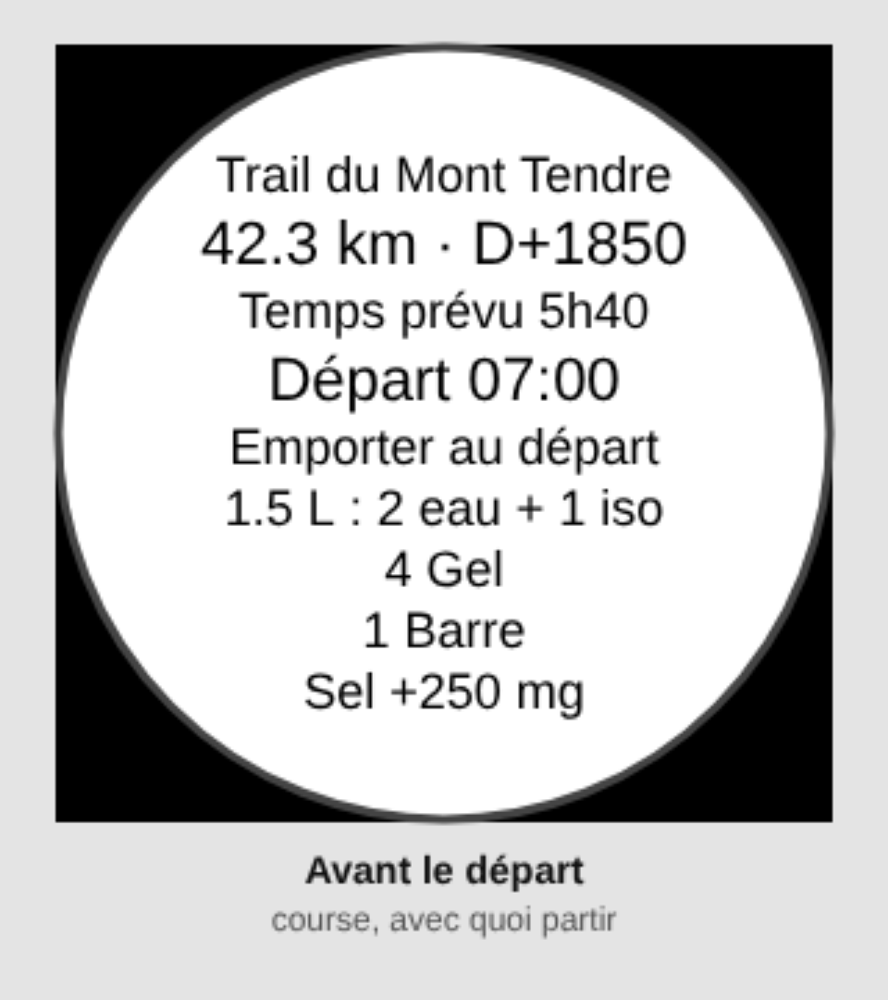
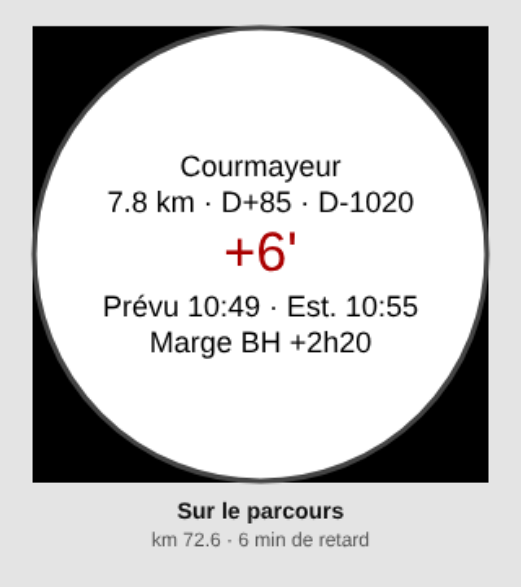
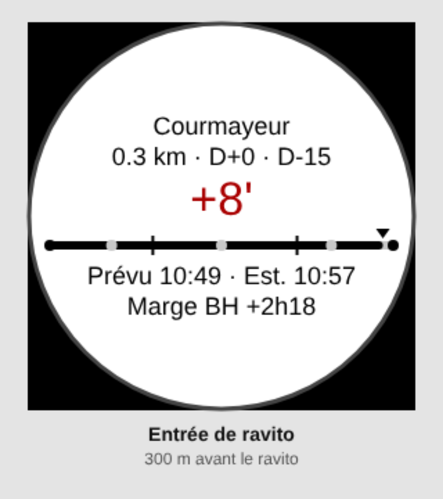
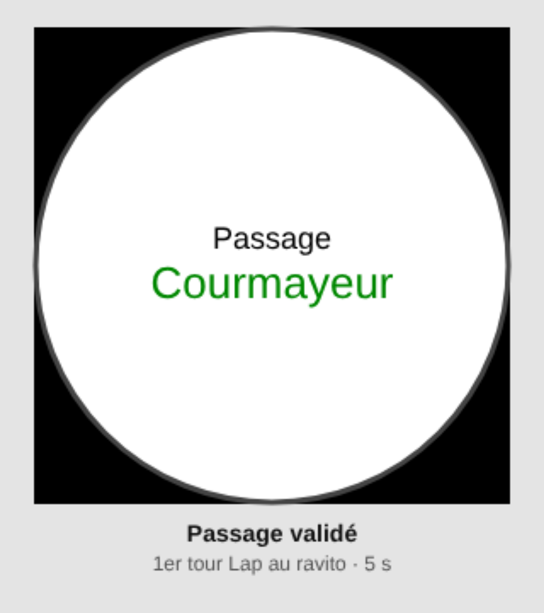
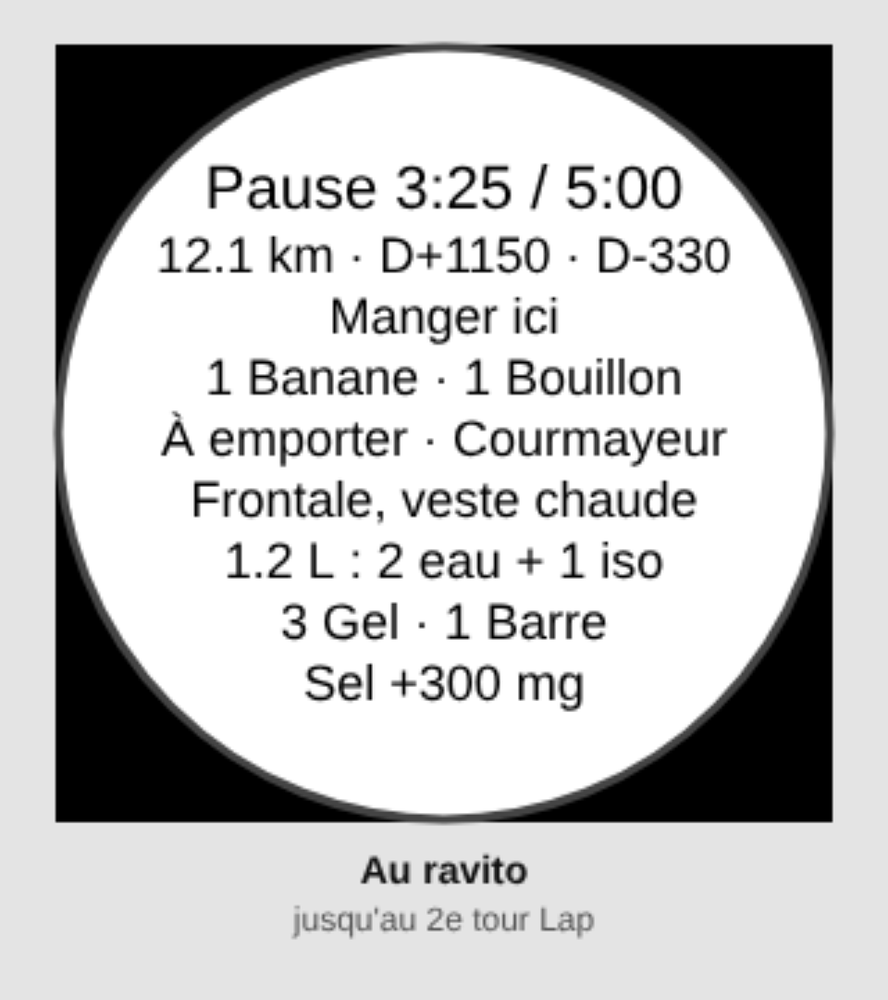
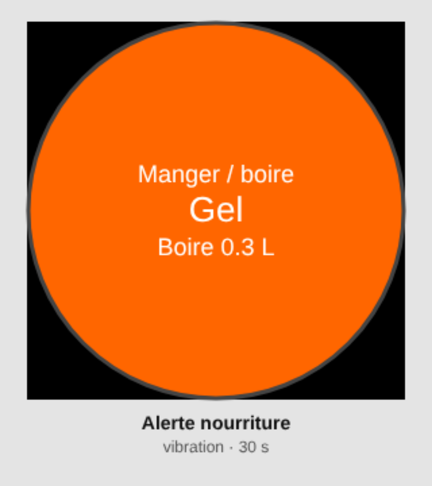
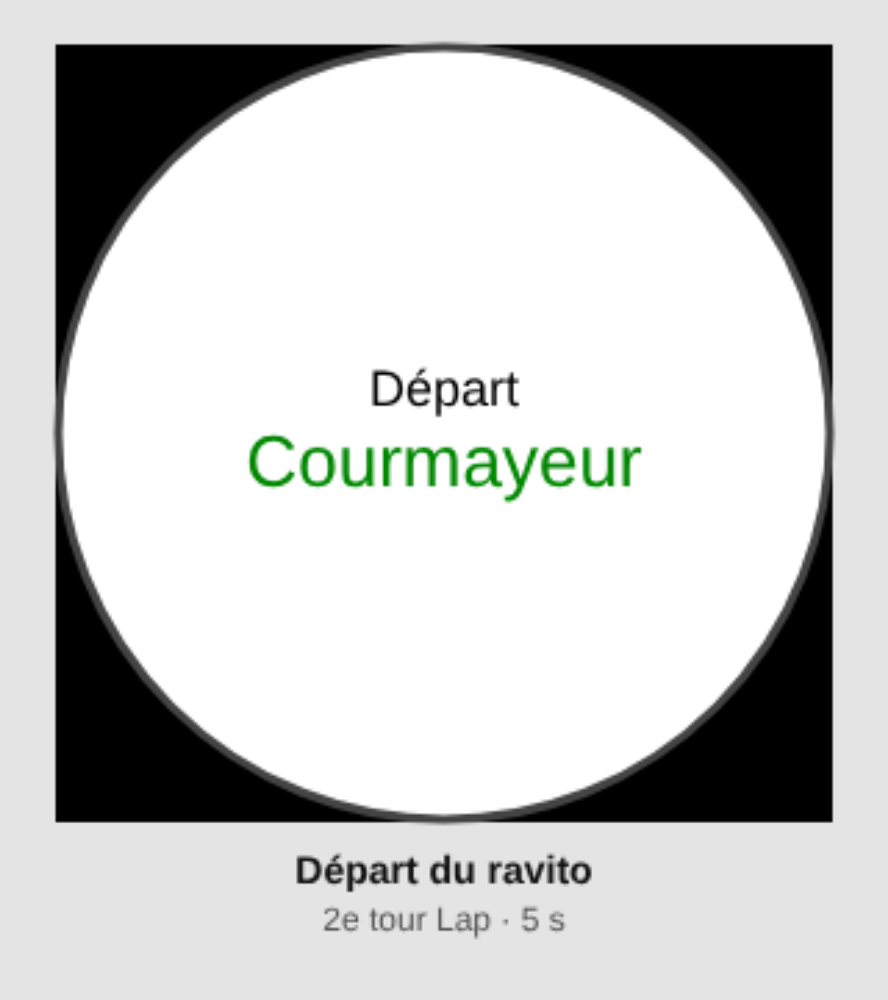

<!--
  Cadre « Applications Garmin » de l'onglet Montre de Trail Planner.

  Pour modifier : sur GitHub, ouvre ce fichier, clique sur le crayon (Edit), change le texte,
  puis « Commit changes » sur main. Le site est mis à jour environ une minute après.

  Règles :
  - Un titre « ## » par application (son nom).
  - Juste sous le titre, des lignes facultatives :
      Type : Champ de données
      Store : lien Connect IQ Store (https://apps.garmin.com/…) ; vide = pas encore publiée
      Image : nom d'un fichier de ce dossier (capture de l'écran de la montre)
      Guide : lien du guide d'installation par câble (sinon celui du dépôt)
      Statut : badge affiché à côté du nom (« Bêta »)
  - Ensuite, du texte libre : paragraphes, listes « - », **gras**, [liens](https://…), images .
  - Plusieurs images à la suite (une par ligne, sans texte entre elles) : galerie qui défile, chaque image
    s'ouvre en grand d'un clic.
  - Images : dépose-les dans ce dossier (public/montre) avec « Add file › Upload files ».
  - Le texte avant le premier « ## » s'affiche en introduction.
-->

Les applications pour ta montre Garmin, à installer depuis le Connect IQ Store (application Connect IQ sur ton
téléphone) : les champs de données s'ajoutent à un écran de ton activité Trail (Paramètres › Écrans de données ›
Connect IQ), l'appli Trail Planner Companion se lance comme une activité.

## Trail Planner
Type : Champ de données
Store :
Image : ecran-trail-planner.png

Ton plan de course au poignet :

- **écart au plan** à l’endroit où tu es (position GPS calée sur le tracé) ;
- **prochain point** : distance, D+ et D- restants, heure prévue et heure estimée ; en option, jusqu'à l'arrivée ;
- **barrières horaires**, **rappels nutrition** (produit prévu) et, à chaque ravito, sac **« À emporter »** avec distance, D+ et D- jusqu'au suivant ;
- **bouton Lap** = passage à un point, estimations recalculées ;
- passages et position envoyés à ton **assistance**.

En course (captures simulées sur Enduro 3) :

Montres : fēnix 5 Plus, 6 Pro, 7, 7 Pro, 8, 9 et E, epix 2, Enduro 3, Forerunner 255, 265, 955 et 965.

## EndurancePro
Type : Champ de données
Store :

Allure cible colorée avec alarme (allure, zone ou % de VC), vitesse ascensionnelle par zone, équivalences
montée et descente. Avec la synchronisation, il reprend ta VC, tes zones et la zone de la séance envoyée.

## Trail Planner Companion
Type : Appli (activité)
Statut : Bêta
Store :
Guide : https://github.com/lionelbonati-lab/Trail-Planner/tree/main/garmin/TrailPlannerCompanion

L'appli qui réunit tout pour la course, à lancer à la place de l'activité Trail :

- **écran de démarrage** : tes courses à venir et les parcours de ta bibliothèque (synchronisation ci-dessous), fiche du parcours avec la carte et le profil, réglages ;
- **EndurancePro** et **Trail Planner** au même style : allure effort, VAM, zones, écart au plan, prochain point, arrivée, ravitos (« À consommer », « À prendre »), rappels nutrition en popup ;
- **profil** de la course qui te suit, zoomable, couleurs des pentes en option ;
- **carte Garmin** avec ton parcours, centrée sur toi ;
- passages et position envoyés à ton **assistance**.

Bêta : à installer par câble (fichier compilé), le même code de synchronisation que les champs.

